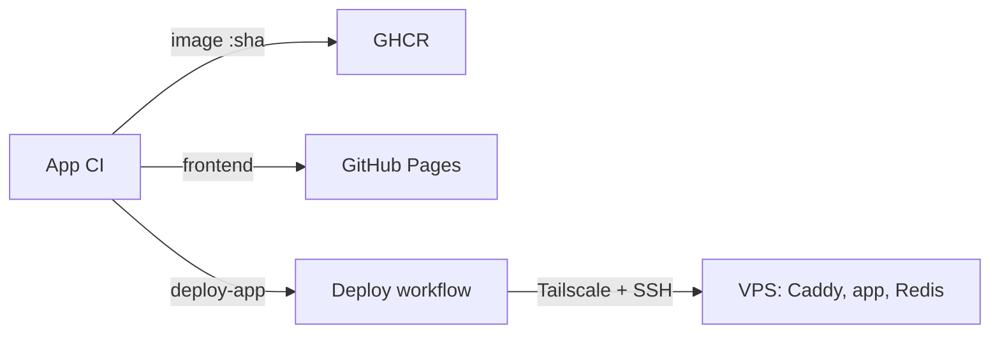

# Into The Fray - Infrastructure

Deployment of the [Into The Fray](https://github.com/alexandreroman/intothefray)
backend: the Go server and its Redis, behind Caddy, on an OVH VPS at
<https://api.intothefray.xyz>. The frontend is published to GitHub Pages at
<https://intothefray.xyz> by the app repo.

## Architecture

For each commit on `main`, the app CI publishes the image, publishes the
frontend, then asks this repo to deploy the image. The frontend may go live a
few minutes before its backend. This repo sends nothing back to the app repo.



On the VPS, only Caddy publishes a port (443). Cloudflare proxies
`api.intothefray.xyz` to it over TLS (Full (strict), Cloudflare Origin CA
certificate), and Caddy forwards everything, WebSockets included, to the app
on `app:9000`. Redis keeps the games in memory only.

| File                           | Purpose                                   |
| ------------------------------ | ----------------------------------------- |
| `compose.yaml`                 | Production stack: caddy, app, redis       |
| `Caddyfile`                    | TLS with the origin certificate, proxy    |
| `scripts/deploy.sh`            | Runs on the VPS: deploy and rollback      |
| `.github/workflows/deploy.yml` | Deploy workflow                           |
| `.env.example`                 | The `.env` the workflow writes on the VPS |
| `Makefile`                     | Local checks of the files above           |

## Validating changes

A push to `main` that touches the stack redeploys it, so check first (needs
`actionlint`, `shellcheck`, `openssl` and Docker; `make` lists each check):

```sh
make check
```

## Deploy workflow

The `Deploy` workflow runs one deploy at a time: a running deploy is never
cancelled, and a newer pending one replaces an older pending one. It is
triggered by:

- `repository_dispatch` `deploy-app`, sent by the app CI with
  `client_payload.sha`: deploys that image;
- a manual run (`workflow_dispatch`), with an optional `sha` input: deploys
  that image, or redeploys the tag running on the VPS when empty;
- a push to `main` that changes the stack (`compose.yaml`, `Caddyfile`,
  `scripts/deploy.sh` or the workflow): redeploys the running tag with the
  new files.

It joins the tailnet as `tag:ci`, uploads the stack files and runs
`deploy.sh deploy [sha]` over SSH, which installs them, pulls the images and
waits until every service is healthy. The workflow then checks
`https://api.intothefray.xyz/healthz` through Cloudflare. On any failure it
runs `deploy.sh rollback`, which restores the previous files and tag, and the
job fails.

Until every secret listed in [GitHub](#github) is set, the workflow still
validates the SHA, then warns which secrets are missing and skips the deploy:
the job ends green.

## Rolling back

Run the `Deploy` workflow by hand (Actions, Deploy, Run workflow) with the
full SHA of an older app commit: its image is still on GHCR and the backend
goes back to it. This rolls back the backend only; the frontend is published
by the app repo. The tag that ran before the current one is in
`/opt/intothefray/.env` as `APP_PREVIOUS_TAG`.

## Reading logs on the VPS

Connect over Tailscale, then:

```bash
cd /opt/intothefray
docker compose ps                        # state and health of each service
docker compose logs --tail 200 app       # last lines of the Go server
docker compose logs -f --since 10m caddy # follow Caddy
cat .env                                 # tag running and the one before
```

## One-time VPS preparation

The VPS runs Ubuntu 26 (amd64, 2 GB of RAM). Keep the OVH KVM console at
hand while setting up the firewall.

- [ ] Update the system and reboot if the kernel changed:

  ```bash
  sudo apt update && sudo apt full-upgrade -y
  ```

- [ ] Turn on unattended security upgrades:

  ```bash
  sudo apt install -y unattended-upgrades
  sudo dpkg-reconfigure -plow unattended-upgrades
  ```

- [ ] Install Docker Engine and the Compose plugin from Docker's apt
  repository, following
  <https://docs.docker.com/engine/install/ubuntu/>.
- [ ] Create the `deploy` user, member of the `docker` group:

  ```bash
  sudo adduser --disabled-password --gecos "" deploy
  sudo usermod -aG docker deploy
  ```

- [ ] Give the workflow an SSH key for `deploy`. The private key becomes the
  `VPS_SSH_KEY` secret; the public key goes into `deploy`'s
  `authorized_keys` on the VPS.

  1. On your machine, in a directory outside this repository, create the
     key pair. It has no passphrase, since the workflow cannot type one:

     ```bash
     ssh-keygen -t ed25519 -N "" -C intothefray-deploy -f intothefray-deploy
     ```

     This writes the private key `intothefray-deploy` and the public key
     `intothefray-deploy.pub`.

  2. Authorize the public key for `deploy`. That user has no password, so go
     through your own account and `sudo`. The `restrict` prefix denies
     terminals and port forwarding but still allows the commands and `scp`
     the workflow runs:

     ```bash
     printf 'restrict %s\n' "$(cat intothefray-deploy.pub)" |
       ssh <your user>@<vps public IP> \
         'sudo install -d -m 700 -o deploy -g deploy /home/deploy/.ssh &&
          sudo tee /home/deploy/.ssh/authorized_keys >/dev/null &&
          sudo chown deploy:deploy /home/deploy/.ssh/authorized_keys &&
          sudo chmod 600 /home/deploy/.ssh/authorized_keys'
     ```

  3. Check the key, store the private key as a secret, then delete both
     files (or keep the private key in a password manager):

     ```bash
     ssh -i intothefray-deploy deploy@<vps public IP> true && echo OK
     gh secret set VPS_SSH_KEY -R alexandreroman/intothefray-infra \
       <intothefray-deploy
     rm intothefray-deploy intothefray-deploy.pub
     ```

- [ ] Add a 2 GB swap file:

  ```bash
  sudo fallocate -l 2G /swapfile
  sudo chmod 600 /swapfile
  sudo mkswap /swapfile
  sudo swapon /swapfile
  echo '/swapfile none swap sw 0 0' | sudo tee -a /etc/fstab
  echo 'vm.swappiness=10' | sudo tee /etc/sysctl.d/99-swappiness.conf
  sudo sysctl --system
  ```

- [ ] Install Tailscale (<https://tailscale.com/download/linux>), join the
  tailnet with the server tag (see [Tailscale](#tailscale)), and disable key
  expiry for this machine in the admin console:

  ```bash
  sudo tailscale up --advertise-tags=tag:vps
  ```

  Check that SSH works over Tailscale before closing port 22 below:
  `ssh <your user>@<vps>.<tailnet>.ts.net`.
- [ ] Set up ufw: SSH on the tailnet only. Docker opens Caddy's port 443
  itself: no ufw rule is needed for it.

  ```bash
  sudo ufw default deny incoming
  sudo ufw default allow outgoing
  sudo ufw allow in on tailscale0 to any port 22 proto tcp
  sudo ufw enable
  ```

- [ ] Create the application directory and the certificate directory:

  ```bash
  sudo mkdir -p /opt/intothefray/certs
  sudo chown -R deploy:deploy /opt/intothefray
  ```

- [ ] Create a Cloudflare Origin CA certificate (SSL/TLS, Origin Server,
  Create certificate) for `api.intothefray.xyz`, and save it as
  `/opt/intothefray/certs/origin.pem` and the private key as
  `/opt/intothefray/certs/origin-key.pem`. Caddy runs as `nobody`
  (65534), so give the key to group `nogroup` (65534), readable by it only:

  ```bash
  sudo chown deploy:nogroup /opt/intothefray/certs/origin-key.pem
  sudo chmod 640 /opt/intothefray/certs/origin-key.pem
  chmod 644 /opt/intothefray/certs/origin.pem
  ```

- [ ] Record the SSH host key for the workflow, from a machine on the
  tailnet, and check its fingerprint against
  `ssh-keygen -lf /etc/ssh/ssh_host_ed25519_key.pub` on the VPS:

  ```bash
  ssh-keyscan -t ed25519 <vps>.<tailnet>.ts.net
  ```

  Its output is the `VPS_SSH_KNOWN_HOSTS` secret. The host name in it must
  be exactly `VPS_HOST`.

## Cloudflare

DNS of `intothefray.xyz`:

| Record | Type | Value                                    | Proxy    |
| ------ | ---- | ---------------------------------------- | -------- |
| `@`    | A    | GitHub Pages: `185.199.108-111.153`      | DNS only |
| `@`    | AAAA | GitHub Pages: `2606:50c0:8000-8003::153` | DNS only |
| `api`  | A    | Public IPv4 address of the VPS           | Proxied  |

- The apex stays DNS only so that GitHub Pages issues its certificate.
- `api` is proxied: it hides the VPS, compresses the responses and carries
  the WebSockets. It needs no AAAA record: Cloudflare reaches the origin over
  IPv4.
- SSL/TLS encryption mode: Full (strict). WebSockets on (the default).

## Tailscale

- In the access controls, declare the tags and let `tag:ci` reach SSH on
  the VPS (merge into the existing policy):

  ```json
  {
    "tagOwners": {
      "tag:ci": ["autogroup:admin"],
      "tag:vps": ["autogroup:admin"]
    },
    "grants": [
      { "src": ["tag:ci"], "dst": ["tag:vps"], "ip": ["tcp:22"] }
    ]
  }
  ```

- Create an OAuth client (Settings, Trust credentials) with the
  `auth_keys` write scope and the tag `tag:ci`. The workflow uses it to
  join as an ephemeral node, removed when the job ends.
- Enable MagicDNS: `VPS_HOST` is the VPS's MagicDNS name.

## GitHub

Secrets of this repository (Settings, Secrets and variables, Actions):

| Secret                | Content                                         |
| --------------------- | ----------------------------------------------- |
| `TS_OAUTH_CLIENT_ID`  | Tailscale OAuth client ID                       |
| `TS_OAUTH_SECRET`     | Tailscale OAuth client secret                   |
| `VPS_HOST`            | MagicDNS name of the VPS (`<vps>.<tailnet>...`) |
| `VPS_USER`            | `deploy`                                        |
| `VPS_SSH_KEY`         | Private key authorized for `deploy`             |
| `VPS_SSH_KNOWN_HOSTS` | `ssh-keyscan` line(s) of the VPS host key       |

The app repo needs the matching `INFRA_DISPATCH_TOKEN` secret (a
fine-grained token limited to this repository, Contents in read and
write), and its GHCR package `intothefray` must be public so that the VPS
pulls without credentials.

## License

Licensed under the [Apache License, Version 2.0](LICENSE).
