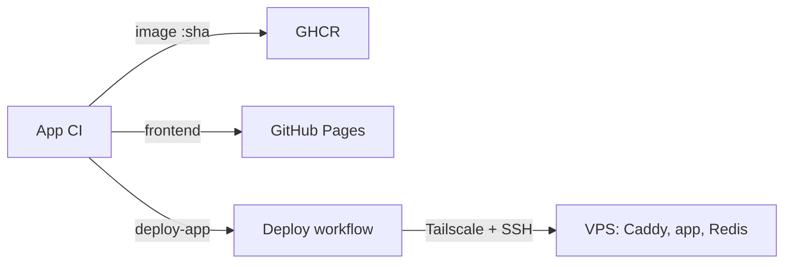

# Into The Fray - Infrastructure

Deployment of the [Into The Fray](https://github.com/alexandreroman/intothefray)
backend: the Go server and its Redis, behind Caddy, on an OVH VPS at
<https://api.intothefray.xyz>. The frontend is published to GitHub Pages at
<https://intothefray.xyz> by the app repo.

## Architecture

For each commit on `main`, the app CI publishes the image, publishes the
frontend, then asks this repo to deploy the image. The frontend may go live a
few minutes before its backend. This repo sends nothing back to the app repo.



On the VPS, only Caddy publishes a port (443). Cloudflare proxies
`api.intothefray.xyz` to it over TLS (Full (strict), Cloudflare Origin CA
certificate), and Caddy forwards everything, WebSockets included, to the app
on `app:9000`. Redis keeps the games in memory only.

| File                           | Purpose                                   |
| ------------------------------ | ----------------------------------------- |
| `compose.yaml`                 | Production stack: caddy, app, redis       |
| `Caddyfile`                    | TLS with the origin certificate, proxy    |
| `scripts/deploy.sh`            | Runs on the VPS: deploy and rollback      |
| `.github/workflows/deploy.yml` | Deploy workflow                           |
| `.env.example`                 | The `.env` the workflow writes on the VPS |
| `Makefile`                     | Local checks of the files above           |

## Validating changes

A push to `main` that touches the stack redeploys it, so check first (needs
`actionlint`, `shellcheck`, `openssl` and Docker; `make` lists each check):

```sh
make check
```

## Deploy workflow

The `Deploy` workflow runs one deploy at a time: a running deploy is never
cancelled, and a newer pending one replaces an older pending one. It is
triggered by:

- `repository_dispatch` `deploy-app`, sent by the app CI with
  `client_payload.sha`: deploys that image;
- a manual run (`workflow_dispatch`), with an optional `sha` input: deploys
  that image, or redeploys the tag running on the VPS when empty;
- a push to `main` that changes the stack (`compose.yaml`, `Caddyfile`,
  `scripts/deploy.sh` or the workflow): redeploys the running tag with the
  new files.

It joins the tailnet as `tag:ci`, uploads the stack files and runs
`deploy.sh deploy [sha]` over SSH, which installs them, pulls the images and
waits until every service is healthy. The workflow then checks
`https://api.intothefray.xyz/healthz` through Cloudflare. On any failure it
runs `deploy.sh rollback`, which restores the previous files and tag, and the
job fails.

Until every secret listed in [GitHub](#github) is set, the workflow still
validates the SHA, then warns which secrets are missing and skips the deploy:
the job ends green.

## Rolling back

Run the `Deploy` workflow by hand (Actions, Deploy, Run workflow) with the
full SHA of an older app commit: its image is still on GHCR and the backend
goes back to it. This rolls back the backend only; the frontend is published
by the app repo. The tag that ran before the current one is in
`/opt/intothefray/.env` as `APP_PREVIOUS_TAG`.

## Reproducing the workflow

The workflow connects as `deploy` with the key created during the
[VPS preparation](#one-time-vps-preparation). With that key and the same SSH
options, any machine on the tailnet runs the same steps. Add to
`~/.ssh/config`:

```text
Host itf-vps
  HostName <vps>.<tailnet>.ts.net
  User deploy
  IdentityFile ~/.ssh/intothefray-deploy
  IdentitiesOnly yes
```

`IdentitiesOnly` stops the SSH agent from offering its other keys first,
which can end in "Too many authentication failures". On the first
connection, check that the fingerprint SSH shows matches
`ssh-keygen -lf /etc/ssh/ssh_host_ed25519_key.pub` on the VPS.

The key is `restrict`ed: it runs commands but opens no terminal, so always
pass a command. Test the access the workflow needs:

```bash
ssh itf-vps true && echo OK                   # SSH as deploy
ssh itf-vps docker compose -f /opt/intothefray/compose.yaml ps  # Docker
```

Run the deploy steps by hand, from the root of this repository. This
really deploys:

```bash
dir=/opt/intothefray/incoming
ssh itf-vps mkdir -p "$dir"
scp -q compose.yaml Caddyfile scripts/deploy.sh "itf-vps:$dir/"
ssh itf-vps sh "$dir/deploy.sh" deploy <sha>  # no SHA: redeploy the tag
curl -sS --fail -o /dev/null https://api.intothefray.xyz/healthz && echo OK
ssh itf-vps sh "$dir/deploy.sh" rollback      # only if a step failed
```

## Reading logs on the VPS

Connect over Tailscale, then:

```bash
cd /opt/intothefray
docker compose ps                        # state and health of each service
docker compose logs --tail 200 app       # last lines of the Go server
docker compose logs -f --since 10m caddy # follow Caddy
cat .env                                 # tag running and the one before
```

## One-time VPS preparation

The VPS runs Ubuntu 26 (amd64, 2 GB of RAM). Keep the OVH KVM console at
hand while setting up the firewall.

- [ ] Update the system and reboot if the kernel changed:

  ```bash
  sudo apt update && sudo apt full-upgrade -y
  ```

- [ ] Turn on unattended security upgrades:

  ```bash
  sudo apt install -y unattended-upgrades
  sudo dpkg-reconfigure -plow unattended-upgrades
  ```

- [ ] Install Docker Engine and the Compose plugin from Docker's apt
  repository, following
  <https://docs.docker.com/engine/install/ubuntu/>.
- [ ] Create the `deploy` user, member of the `docker` group:

  ```bash
  sudo adduser --disabled-password --gecos "" deploy
  sudo usermod -aG docker deploy
  ```

- [ ] Give the workflow an SSH key for `deploy`. The private key becomes the
  `VPS_SSH_KEY` secret; the public key goes into `deploy`'s
  `authorized_keys` on the VPS.

  1. On your machine, create the key pair. It has no passphrase, since the
     workflow cannot type one:

     ```bash
     ssh-keygen -t ed25519 -N "" -C intothefray-deploy \
       -f ~/.ssh/intothefray-deploy
     ```

     This writes the private key `~/.ssh/intothefray-deploy` and the public
     key `~/.ssh/intothefray-deploy.pub`. Keep both: the private key lets
     you [reproduce the workflow](#reproducing-the-workflow) from your
     machine.

  2. Authorize the public key for `deploy`. That user has no password, so go
     through your own account and `sudo`. The `restrict` prefix denies
     terminals and port forwarding but still allows the commands and `scp`
     the workflow runs:

     ```bash
     printf 'restrict %s\n' "$(cat ~/.ssh/intothefray-deploy.pub)" |
       ssh <your user>@<vps public IP> \
         'sudo install -d -m 700 -o deploy -g deploy /home/deploy/.ssh &&
          sudo tee /home/deploy/.ssh/authorized_keys >/dev/null &&
          sudo chown deploy:deploy /home/deploy/.ssh/authorized_keys &&
          sudo chmod 600 /home/deploy/.ssh/authorized_keys'
     ```

  3. Check the key, then store the private key as a secret:

     ```bash
     ssh -i ~/.ssh/intothefray-deploy deploy@<vps public IP> true && echo OK
     gh secret set VPS_SSH_KEY -R alexandreroman/intothefray-infra \
       <~/.ssh/intothefray-deploy
     ```

- [ ] Add a 2 GB swap file:

  ```bash
  sudo fallocate -l 2G /swapfile
  sudo chmod 600 /swapfile
  sudo mkswap /swapfile
  sudo swapon /swapfile
  echo '/swapfile none swap sw 0 0' | sudo tee -a /etc/fstab
  echo 'vm.swappiness=10' | sudo tee /etc/sysctl.d/99-swappiness.conf
  sudo sysctl --system
  ```

- [ ] Put the VPS on the tailnet. SSH keeps using the VPS's own OpenSSH
  server (not Tailscale SSH); Tailscale only carries the traffic.

  1. In the Tailscale admin console, apply the access controls from
     [Tailscale](#tailscale) first: the VPS cannot take the `tag:vps` tag
     until the policy declares it.
  2. On the VPS, install Tailscale and join with the tag:

     ```bash
     curl -fsSL https://tailscale.com/install.sh | sh
     sudo tailscale up --advertise-tags=tag:vps
     ```

     `tailscale up` prints a login URL: open it and sign in as the tailnet
     owner or an admin. A tagged machine belongs to the tailnet, not to a
     user, and its key does not expire. Check it on the VPS:

     ```bash
     tailscale status --json | jq '.Self.Tags'   # ["tag:vps"]
     ```

     If the VPS already joined without the tag, re-register it with the
     tag rather than adding the tag in the admin console, which can leave
     the machine tagged in the console but not on the VPS itself. This
     drops the VPS from the tailnet until you open the new login URL, so
     run it from an SSH session on the public IP or from the OVH KVM
     console, not over Tailscale:

     ```bash
     sudo tailscale up --advertise-tags=tag:vps --force-reauth
     ```

  3. Note the VPS's MagicDNS name, `<vps>.<tailnet>.ts.net`: it is shown in
     the admin console (Machines) and is the `VPS_HOST` secret.
  4. On your machine, install Tailscale (<https://tailscale.com/download>;
     on macOS, turn on its command-line tool in the app's settings) and sign
     in to the same tailnet. Then check, before closing port 22 below, that
     the VPS answers over the tailnet and that the workflow's SSH access
     works through it. This is the plain `ssh` command, not `tailscale ssh`:

     ```bash
     tailscale status --json |
       jq '.Peer[] | select(.HostName == "<vps>") | .Tags'  # ["tag:vps"]
     tailscale ping <vps>.<tailnet>.ts.net
     ssh -i ~/.ssh/intothefray-deploy deploy@<vps>.<tailnet>.ts.net true \
       && echo OK
     ```

     If `tailscale ping` answers but SSH times out, the access controls
     block it: check that the VPS has the tag and that you are covered by
     the third grant in [Tailscale](#tailscale).

- [ ] Set up ufw: SSH on the tailnet only. Docker opens Caddy's port 443
  itself: no ufw rule is needed for it.

  ```bash
  sudo ufw default deny incoming
  sudo ufw default allow outgoing
  sudo ufw allow in on tailscale0 to any port 22 proto tcp
  sudo ufw enable
  ```

- [ ] Create the application directory and the certificate directory:

  ```bash
  sudo mkdir -p /opt/intothefray/certs
  sudo chown -R deploy:deploy /opt/intothefray
  ```

- [ ] Install a Cloudflare Origin CA certificate. Caddy presents it to
  Cloudflare, which requires a valid one in Full (strict) mode (error 526
  otherwise). Only Cloudflare trusts it, which is enough since browsers
  never reach the VPS directly, and it lasts up to 15 years.

  1. In the Cloudflare dashboard, open `intothefray.xyz`, then SSL/TLS,
     Origin Server, Create Certificate, and choose:
     - Generate private key and CSR with Cloudflare, key type ECC;
     - hostnames: only `api.intothefray.xyz` (remove the default
       `intothefray.xyz` and `*.intothefray.xyz`);
     - certificate validity: 15 years.
  2. Cloudflare shows the origin certificate and its private key, in PEM
     format. Leave the page open: the private key is shown only once.
  3. On the VPS, through your own account, paste each one into its file
     (end each paste with Ctrl-D). The key is created unreadable by others
     from the start:

     ```bash
     cd /opt/intothefray/certs
     sudo -u deploy tee origin.pem >/dev/null
     sudo -u deploy sh -c 'umask 077; cat >origin-key.pem'
     ```

  4. Caddy runs as `nobody` (65534): give the key to group `nogroup`
     (65534), readable by it only, and the certificate to everyone:

     ```bash
     sudo chown deploy:nogroup origin-key.pem
     sudo chmod 640 origin-key.pem
     sudo chmod 644 origin.pem
     ```

  5. Check the name and the expiry date, and that the key matches the
     certificate (both hashes must be equal):

     ```bash
     openssl x509 -in origin.pem -noout -subject -enddate
     openssl x509 -in origin.pem -noout -pubkey | sha256sum
     sudo openssl pkey -in origin-key.pem -pubout | sha256sum
     ```

  The key never goes into git, nor anywhere else than this file. Set a
  reminder before the expiry date. If the key leaks, revoke the certificate
  in SSL/TLS, Origin Server, and create a new one.

- [ ] Record the VPS's SSH host key for the workflow. The runner starts
  fresh on every run, so it cannot accept the key on first use: it connects
  with `StrictHostKeyChecking yes` and trusts only the keys in the
  `VPS_SSH_KNOWN_HOSTS` secret. That way, nothing but the VPS can receive
  the deploy key.

  1. On the VPS, read the fingerprint of its ED25519 host key:

     ```bash
     ssh-keygen -lf /etc/ssh/ssh_host_ed25519_key.pub
     ```

  2. On your machine, on the tailnet, fetch the key under the exact name
     the workflow connects to, the MagicDNS name of `VPS_HOST`, then print
     its fingerprint. It must match the one from step 1:

     ```bash
     ssh-keyscan -t ed25519 <vps>.<tailnet>.ts.net 2>/dev/null \
       >vps-known-hosts
     ssh-keygen -lf vps-known-hosts
     ```

     The file holds one line, `<vps>.<tailnet>.ts.net ssh-ed25519 AAAA...`.
     SSH looks the key up by that name, so it must be exactly `VPS_HOST`.

  3. Store the line and the name as secrets, then delete the file:

     ```bash
     gh secret set VPS_SSH_KNOWN_HOSTS -R alexandreroman/intothefray-infra \
       <vps-known-hosts
     gh secret set VPS_HOST -R alexandreroman/intothefray-infra \
       --body '<vps>.<tailnet>.ts.net'
     rm vps-known-hosts
     ```

  Redo this step when the VPS is reinstalled or renamed in the tailnet: the
  workflow then fails with "Host key verification failed".

## Cloudflare

DNS of `intothefray.xyz`:

| Record | Type | Value                                    | Proxy    |
| ------ | ---- | ---------------------------------------- | -------- |
| `@`    | A    | GitHub Pages: `185.199.108-111.153`      | DNS only |
| `@`    | AAAA | GitHub Pages: `2606:50c0:8000-8003::153` | DNS only |
| `api`  | A    | Public IPv4 address of the VPS           | Proxied  |

- The apex stays DNS only so that GitHub Pages issues its certificate.
- `api` is proxied: it hides the VPS, compresses the responses and carries
  the WebSockets. It needs no AAAA record: Cloudflare reaches the origin over
  IPv4.
- SSL/TLS encryption mode: Full (strict), minimum TLS version 1.2, Always
  Use HTTPS on. These zone settings only apply to proxied records, so not
  to the apex.
- WebSockets, HTTP/3, TLS 1.3 and Brotli on (the defaults). Cloudflare
  compresses the JSON responses itself; the WebSocket traffic, which
  carries most of a game, passes through as is.

## Tailscale

The workflow reaches the VPS only through the tailnet: each run joins it as
a short-lived machine tagged `tag:ci`, and the policy lets that tag reach
SSH on the machine tagged `tag:vps`, nothing else. Everything below is done
once, in the Tailscale admin console.

1. **Access controls.** Open Access controls, then the JSON editor, and
   merge this into the policy (add the keys to the existing `tagOwners` and
   `grants` rather than replacing them):

   ```json
   {
     "tagOwners": {
       "tag:ci": ["autogroup:owner", "autogroup:admin"],
       "tag:vps": ["autogroup:owner", "autogroup:admin"]
     },
     "grants": [
       {
         "src": ["autogroup:member"],
         "dst": ["autogroup:self"],
         "ip": ["*"]
       },
       { "src": ["tag:ci"], "dst": ["tag:vps"], "ip": ["tcp:22"] },
       {
         "src": ["autogroup:owner", "autogroup:admin"],
         "dst": ["tag:vps"],
         "ip": ["tcp:22"]
       }
     ],
     "tests": [
       { "src": "tag:ci", "accept": ["tag:vps:22"], "deny": ["tag:vps:443"] }
     ]
   }
   ```

   - `tagOwners` declares the tags and lets the tailnet owner and admins
     apply them: the VPS cannot join with `tag:vps`, nor the OAuth client
     below use `tag:ci`, until they are declared. `autogroup:admin` covers
     the Admin role only, not the Owner (the creator of a personal tailnet):
     list both.
   - The first grant lets each user's own devices reach one another; tagged
     machines such as the VPS are not part of it.
   - The second is the workflow's only access: SSH on the VPS.
   - The third keeps your own SSH access to the VPS once port 22 is closed
     to the Internet.
   - `tests` makes the console refuse to save a policy that would cut the
     workflow off from SSH or open it more. Add a test with your own login
     as `src` and `"accept": ["tag:vps:22"]` to guard your access too.

   A new tailnet's policy starts with an allow-all grant
   (`"src": ["*"], "dst": ["*"], "ip": ["*"]`). Replace it with the grants
   above, so that CI runs reach SSH on the VPS only and the narrower grants
   are the ones that apply.

2. **OAuth client.** The workflow joins the tailnet with an OAuth client
   rather than an auth key: an auth key expires after 90 days at most,
   while an OAuth client does not. On every run,
   `tailscale/github-action` uses the client to create an auth key for an
   ephemeral machine tagged `tag:ci`, which Tailscale removes once the job
   ends.

   1. Open Settings, Trust credentials, and add a credential of type OAuth,
      described for example as `intothefray-infra deploy`.
   2. Grant it a single scope, Keys, Auth Keys, in **write**: that is all
      the action needs. Writing auth keys asks for their tags: add
      `tag:ci`, the only tag the client may use (an OAuth client belongs to
      no user, so at least one tag is required). The tag must already be in
      `tagOwners` (step 1).
   3. Generate the client. Tailscale shows its client ID and its secret
      (`tskey-client-...`); the secret is shown only once.
   4. Store both as repository secrets. Each command prompts for the value,
      which keeps it out of the shell history:

      ```bash
      gh secret set TS_OAUTH_CLIENT_ID -R alexandreroman/intothefray-infra
      gh secret set TS_OAUTH_SECRET -R alexandreroman/intothefray-infra
      ```

   The first deploy checks it: the "Join the tailnet" step succeeds and the
   Machines page lists an ephemeral machine tagged `tag:ci` until the job
   ends. If the secret leaks, delete the client in Trust credentials,
   create a new one and replace both secrets.

3. **MagicDNS.** Check on the DNS page that MagicDNS is on (the default on
   recent tailnets). The page also shows the tailnet name: the VPS's
   MagicDNS name, `<vps>.<tailnet>.ts.net`, is the `VPS_HOST` secret, and
   the workflow pings it right after joining.

## GitHub

Secrets of this repository (Settings, Secrets and variables, Actions):

| Secret                | Content                                         |
| --------------------- | ----------------------------------------------- |
| `TS_OAUTH_CLIENT_ID`  | Tailscale OAuth client ID                       |
| `TS_OAUTH_SECRET`     | Tailscale OAuth client secret                   |
| `VPS_HOST`            | MagicDNS name of the VPS (`<vps>.<tailnet>...`) |
| `VPS_USER`            | `deploy`                                        |
| `VPS_SSH_KEY`         | Private key authorized for `deploy`             |
| `VPS_SSH_KNOWN_HOSTS` | `ssh-keyscan` line(s) of the VPS host key       |

The app repo needs the matching `INFRA_DISPATCH_TOKEN` secret (a
fine-grained token limited to this repository, Contents in read and
write), and its GHCR package `intothefray` must be public so that the VPS
pulls without credentials.

## License

Licensed under the [Apache License, Version 2.0](LICENSE).
